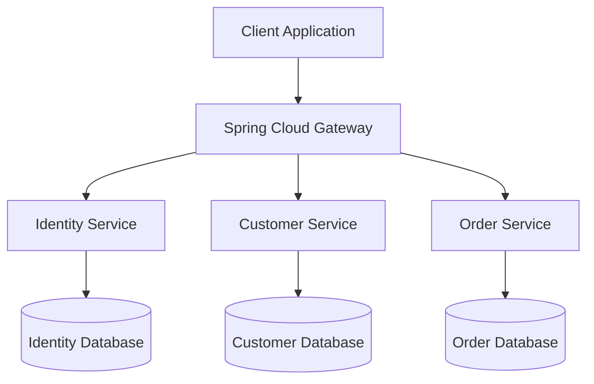

# Java Backend Architecture

## 1. Document Information

- Project: Java Backend Architecture
- Author: Rajkumar Vijay More
- Status: Proposed Architecture
- Version: 0.1
- Implementation: Not Started

> This document describes the target architecture.
> Components and technologies are subject to validation
> during implementation.

---

## 2. Architecture Objectives

Build a modular, secure and maintainable backend system
using Java and the Spring ecosystem.

Primary objectives:

- Clear separation of responsibilities
- Independently deployable business services
- Secure REST API communication
- Database ownership per service
- Testable and maintainable components
- Observable application behavior
- Incremental implementation

---

## 3. High-Level Architecture

### Request Flow

1. Client sends an HTTPS request.
2. API Gateway receives the request.
3. Gateway applies routing and configured policies.
4. The target service validates authorization.
5. The service executes its business logic.
6. The service accesses its owned database.
7. The response returns through the gateway.

---

## 4. Proposed Technology Stack

| Layer | Technology |
|---|---|
| Language | Java |
| Framework | Spring Boot |
| API Gateway | Spring Cloud Gateway |
| Security | Spring Security |
| Authentication | JWT-based (design pending) |
| Persistence | Spring Data JPA / Hibernate |
| Database | MySQL |
| Build Tool | Maven |
| API Documentation | OpenAPI / Swagger |
| Containerization | Docker |
| CI | GitHub Actions |
| Logging | SLF4J / Logback |

Exact framework and Java versions will be selected
before implementation.

---

## 5. Service Responsibilities

### 5.1 API Gateway

Proposed responsibilities:

- Centralized API routing
- Request correlation
- Configurable rate limiting
- Cross-origin configuration
- Authentication integration
- Consistent gateway-level error responses

Business authorization remains the responsibility
of the relevant application services.

### 5.2 Identity Service

Proposed responsibilities:

- User identity management
- Credential verification
- Authentication endpoints
- Token issuance, subject to security design
- Role and permission management

Token signing, refresh, revocation and key rotation
require further architectural decisions.

### 5.3 Customer Service

Proposed responsibilities:

- Customer creation and updates
- Customer information retrieval
- Input validation
- Customer-related business rules
- Customer database ownership

### 5.4 Order Service

Proposed responsibilities:

- Order creation
- Order status management
- Order information retrieval
- Order business validations
- Order database ownership

Cross-service customer validation must not rely
on direct access to the Customer database.

---

## 6. Database Architecture

Each business service owns its persistence model.

Principles:

- No direct cross-service database access
- Service-specific entity and repository layers
- Database changes tracked by migrations
- Explicit transactional boundaries
- No distributed ACID transaction assumption

Initially, separate MySQL schemas may be used
for local development.

Production database isolation will be decided
based on deployment and operational requirements.

---

## 7. Security Architecture

Proposed controls:

- HTTPS at the external boundary
- Spring Security for protected APIs
- JWT validation for authenticated requests
- Role- and permission-based authorization
- Secure credential storage
- Secret management through environment or
  dedicated secret-management facilities
- No credentials in source control

Security decisions still required:

- JWT issuer and token format
- Signing algorithm and key management
- Token expiration and refresh strategy
- Revocation strategy
- Service-to-service authentication
- Gateway and service authorization boundaries

---

## 8. Service Communication

### Initial Approach

Synchronous REST communication for use cases
requiring immediate responses.

### Future Evaluation

Asynchronous messaging can be introduced
where eventual consistency is acceptable.

Potential technologies:

- Apache Kafka
- Transactional outbox pattern
- Retry and dead-letter handling

These capabilities are not yet implemented.

---

## 9. Exception Handling

Each application service should provide:

- Centralized exception handling
- Appropriate HTTP status codes
- Consistent structured error responses
- Request correlation identifiers
- Safe client-facing error messages

Internal stack traces and sensitive data
must not be exposed to API consumers.

---

## 10. Observability

Planned operational capabilities:

- Structured application logs
- Request and correlation identifiers
- Health and readiness endpoints
- Application metrics
- Distributed tracing evaluation

Logging must exclude passwords, access tokens,
personal data and other sensitive information.

---

## 11. Testing Strategy

Planned testing levels:

1. Unit tests for business logic
2. Controller and API tests
3. Repository integration tests
4. Security authorization tests
5. Service integration tests
6. End-to-end workflow tests

Automated tests will be integrated into CI.

---

## 12. Deployment Strategy

### Local Development

- Maven for building services
- Docker Compose for local dependencies
- MySQL for persistent storage

### CI/CD

Proposed GitHub Actions pipeline:

1. Checkout source
2. Configure Java
3. Compile modules
4. Execute automated tests
5. Package application artifacts
6. Report build status

Deployment automation will be designed separately.

---

## 13. Architectural Trade-offs

### Microservices vs Modular Monolith

Microservices offer independent deployment and
service ownership but introduce network,
operational and consistency complexity.

We will begin with a small working service
and evolve toward the target architecture.

### Synchronous vs Asynchronous Communication

REST simplifies request-response workflows.
Messaging improves decoupling in suitable
use cases but introduces eventual consistency
and additional infrastructure.

### Database per Service

Improves ownership and isolation but complicates
cross-service reporting and distributed workflows.

---

## 14. Architecture Decisions Pending

- ADR-001: Java and Spring Boot versions
- ADR-002: Build and repository structure
- ADR-003: Authentication architecture
- ADR-004: Database isolation strategy
- ADR-005: Service communication approach
- ADR-006: Observability stack
- ADR-007: Container and deployment strategy

Decisions will be documented before implementing
the affected capabilities.

---

## 15. Implementation Status

- [x] Repository initialized
- [x] Initial README prepared
- [ ] Architecture approved
- [ ] Technology versions finalized
- [ ] First Spring Boot service implemented
- [ ] Automated tests configured
- [ ] Database integration completed
- [ ] API Gateway integrated
- [ ] Authentication implemented
- [ ] Additional services implemented
- [ ] Containerized local environment created
- [ ] CI workflow configured

---

## Author

Rajkumar Vijay More

Senior Java Developer | Backend Engineer

GitHub:
https://github.com/rajkumarmore7
